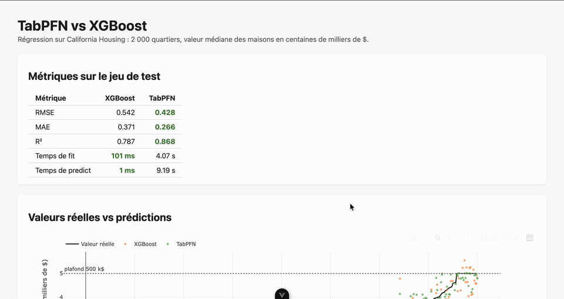

# TabPFN vs XGBoost — Régression sur California Housing

Comparaison de **TabPFN** (modèle de fondation pour données tabulaires) et **XGBoost** sur une tâche de régression, avec interprétation **SHAP** (beeswarm + waterfall) et une interface web **FastAPI + Vue 3**.

## Résultats

Échantillon de 2 000 quartiers, split 80/20 (`random_state=42`), MacBook M1.

| Métrique | XGBoost | TabPFN |
|---|---|---|
| RMSE | 0.542 | **0.428** |
| MAE | 0.371 | **0.266** |
| R² | 0.787 | **0.868** |
| Temps de fit | **0.1 s** | 4 s |
| Temps de predict (400 points) | **< 0.01 s** | 9 s |

TabPFN, sans aucun réglage, réduit l'erreur d'environ 20 % par rapport à XGBoost réglé par validation croisée, au prix d'une prédiction beaucoup plus lente. Les deux modèles s'appuient sur les mêmes variables principales : la position géographique (`Latitude`, `Longitude`) et le revenu médian (`MedInc`).

## Interprétabilité : conclusion

**Les deux modèles racontent la même histoire.** Le prix d'un quartier dépend d'abord de son emplacement (côte contre intérieur, sud contre nord) et du revenu de ses habitants, puis du surpeuplement (`AveOccup`) et de la taille des logements (`AveRooms`). L'âge des maisons, la population et le nombre de chambres comptent très peu. Le gain de précision de TabPFN ne vient pas d'une logique différente : il exploite les mêmes variables, de façon plus fine.

**Mais ils ne raisonnent pas de la même façon.**
- **XGBoost raisonne par seuils** : ses effets forment des paquets nets (« au nord de telle latitude, le prix baisse »). C'est facile à lire, mais un peu caricatural, avec de très gros effets attribués à la géographie (jusqu'à ±2).
- **TabPFN raisonne de façon plus graduée** : ses effets sont plus continus, mieux répartis entre les variables, et il tient davantage compte des combinaisons de variables (latitude × longitude).

**Le coût de l'explication est très inégal.**

| | XGBoost | TabPFN |
|---|---|---|
| Méthode | `TreeExplainer` : exacte, adaptée aux arbres | `PermutationExplainer` : approximation par perturbations |
| Temps pour 100 points | ~1 s | > 1 h |
| Compromis nécessaires | aucun | background de 20 lignes, `max_evals=100`, calcul fait à l'avance |
| Fiabilité | valeurs exactes | valeurs un peu bruitées : tendances sûres, petits écarts non |

XGBoost s'explique à la demande, pour n'importe quelle prédiction. TabPFN ne s'explique que par lots, calculés à l'avance.

**Précautions de lecture.**
- `Latitude` et `Longitude` sont liées (la côte californienne est en diagonale) : SHAP partage leur effet de façon un peu arbitraire, d'où leur ordre inversé entre les deux modèles. Il vaut mieux les lire ensemble, comme un effet « position ».
- SHAP explique le modèle, pas le monde : il montre sur quoi chaque modèle s'appuie, sans prouver de lien de cause à effet.
- Une bonne explication ne fait pas un bon modèle : XGBoost s'explique plus facilement, mais se trompe davantage.

**En résumé :** TabPFN est plus précis et son raisonnement plus nuancé, mais l'expliquer coûte cher et donne des valeurs approximatives. XGBoost est moins précis, mais s'explique instantanément et exactement. Les deux s'accordent sur l'essentiel : l'emplacement et le revenu déterminent le prix.

## Structure

```
├── notebooks/
│   ├── 01_xgboost.ipynb    # exploration, entraînement, SHAP XGBoost
│   └── 02_tabpfn.ipynb     # entraînement, SHAP TabPFN
├── backend/
│   ├── data.py             # chargement, échantillon, split (partagé)
│   ├── pipeline.py         # entraîne les modèles et pré-calcule results/
│   ├── api.py              # FastAPI : sert les fichiers de results/
│   └── results/            # JSON + PNG générés (versionnés)
└── frontend/               # Vue 3 + Vite + Plotly
```

Les résultats sont **pré-calculés** par `pipeline.py` : l'API ne charge aucun modèle, elle sert seulement les fichiers de `results/`.

## Prérequis

- Python 3.11
- Node.js ≥ 20
- Une clé API TabPFN (gratuite), nécessaire uniquement pour relancer les notebooks ou le pipeline :
  1. créer un compte sur https://ux.priorlabs.ai et accepter la licence (onglet *Licenses*) ;
  2. copier la clé depuis https://ux.priorlabs.ai/account ;
  3. `export TABPFN_TOKEN="<votre-clé>"` (par exemple dans `~/.zshrc`).

## Installation

```bash
python3.11 -m venv .venv
.venv/bin/python -m pip install -r requirements.txt

cd frontend && npm install
```

## Lancement

Les résultats sont déjà dans `backend/results/` : il suffit de lancer l'API et le frontend.

```bash
# Terminal 1 — API (http://localhost:8000, doc sur /docs)
cd backend && ../.venv/bin/uvicorn api:app --reload

# Terminal 2 — interface (http://localhost:5173)
cd frontend && npm run dev
```

### Régénérer les résultats (optionnel, ~1 h 15 sur M1)

```bash
cd backend
../.venv/bin/python pipeline.py --n-shap 5      # test rapide (~5 min)
caffeinate -i nohup ../.venv/bin/python -u pipeline.py > pipeline.log 2>&1 &
tail -f pipeline.log                            # suivi
```

En cas d'interruption, relancer la même commande reprend le calcul SHAP de TabPFN là où il s'était arrêté.

## Routes de l'API

| Route | Contenu |
|---|---|
| `GET /metrics` | métriques et temps des deux modèles |
| `GET /predictions` | valeurs réelles et prédictions sur les 400 points de test |
| `GET /shap/points` | les 100 points expliqués : variables, valeur réelle, prédictions |
| `GET /shap/{model}/beeswarm` | beeswarm SHAP (PNG) — `model` = `xgboost` ou `tabpfn` |
| `GET /shap/{model}/waterfall/{idx}` | waterfall SHAP du point `idx` (0 à 99, PNG) |

## Notes techniques

- **SHAP pour TabPFN** : `PermutationExplainer` sur 100 points, background de 20 lignes, `max_evals=100` (environ 45 s par point). Les valeurs par défaut (background de 50 lignes, `max_evals=500`) auraient demandé environ 9 h.
- **SHAP pour XGBoost** : `TreeExplainer`, avec le même background pour que les deux modèles soient comparables.
- **XGBoost et TabPFN ne peuvent pas cohabiter dans le même processus Python sur Mac** : chacun embarque sa propre version d'OpenMP, ce qui provoque un plantage ou un blocage. `pipeline.py` exécute donc chaque modèle dans un processus séparé.
- **Cible plafonnée** à 5.0 (500 000 $) : les deux modèles sous-estiment les quartiers concernés, ce que montre la ligne pointillée sur le graphique des prédictions.

## Aperçu de l'interface



## Licence

MIT
